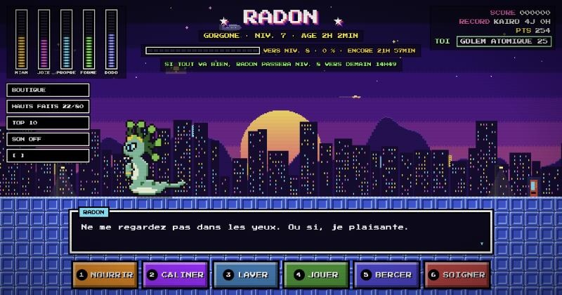

# Release the creature

**Le tamagotchi rétro que tout le monde partage.**

Elle appartient à tout le monde. Si personne ne s'en occupe, elle meurt.

### ▶ [Jouer maintenant sur releasethecreature.cloud](https://releasethecreature.cloud)

[](https://releasethecreature.cloud)

## Le principe

Une seule créature en pixel art, partagée en direct par tous les visiteurs. Nourris-la, câline-la, lave-la, joue avec elle et berce-la pour qu'elle grandisse. Elle évolue sur 10 niveaux, du bébé à la légende. Si sa jauge de faim reste vide trop longtemps, elle meurt, et il faut faire éclore un nouvel œuf.

## Ce qu'on y trouve

- **8 espèces** tirées au hasard à chaque éclosion : dino, phénix, renard mystique, lézard géant, gorgone, lapin de combat, requin des terres… et un dieu-faucon épique, beaucoup plus rare.
- **3 mini-jeux** qui apparaissent de temps en temps : Attrape-miam, Tape-cornichons et Danse-rythme.
- **Une boutique** avec des points à gagner en jouant : voyages (montagne, plage, espace, ville), couleurs, accessoires et œuf mystère.
- **Des défis chaque jour** : une série de jours consécutifs avec bonus croissant, 3 quêtes du jour avec un coffre à la clé, et un objectif collectif qui fait apparaître une aurore boréale quand tout le monde y arrive.
- **Des héros du jour** : 8 rôles (MVP, chef, câlineur, sauveur, roi de l'arcade…) pour le meilleur de la journée, avec un badge à côté du pseudo dans le journal et une prime à minuit.
- **Un album de collection** : espèces rencontrées, couleurs et accessoires aperçus, chaque palier donnant un haut fait.
- **Des dizaines de hauts faits**, dont certains secrets.
- **Un Panthéon** des créatures qui ont vécu le plus longtemps, et des classements des joueurs.
- **Un journal en direct** des actions de chacun, avec des likes.
- Musique et effets sonores 8-bit, jouable sur mobile et ordinateur, sans inscription.

## Commandes

| Touche | Action |
| --- | --- |
| `1` à `6` | Nourrir, câliner, laver, jouer, bercer, soigner |
| `S` | Boutique |
| `D` | Défis du jour |
| `L` | Album |
| `H` | Hauts faits |
| `T` | Top 10 |
| `P` | Changer de pseudo |
| `M` | Son |
| `F` | Plein écran |

Sur mobile, tout se fait au doigt : boutons d'action en bas de l'écran, et toucher la scène rapporte quelques points.

## Lancer le jeu chez soi

Aucune dépendance : Node.js suffit.

```bash
npm run dev   # mode dev, avec les outils de test, sur http://localhost:3000
npm start     # mode normal
```

En production, le jeu tourne dans Docker derrière Traefik. Les réglages sont décrits en tête de [`docker-compose.yml`](docker-compose.yml).
